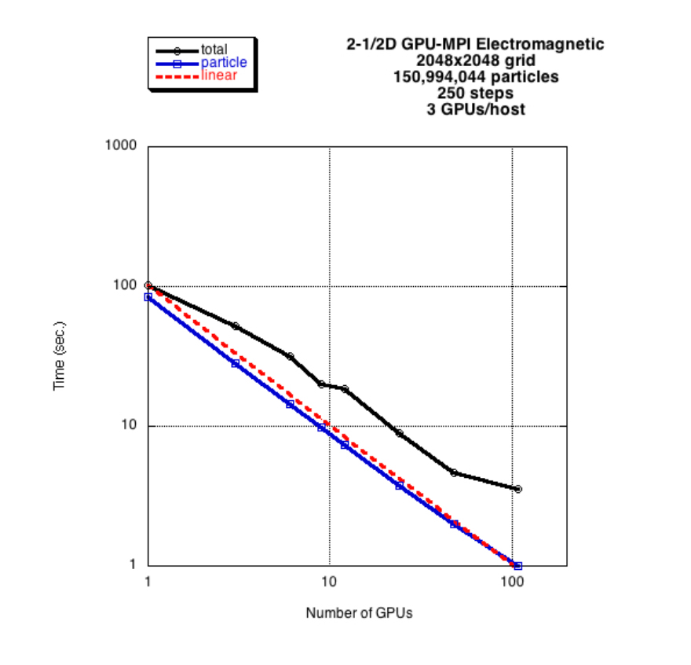

## GPU Tutorial

Tutorial for Computing on GPUs: [gpututorial](/downloads/gpu-tutorial.tar.gz).

## GPU Codes with two levels of parallelism

These codes illustrate how to implement an optimal PIC algorithm on a GPU. It uses a hybrid tiling scheme
with SIMD vectorization, both written with NVIDIA’s CUDA programming environment. The tiling algorithm used within
a thread block on the GPU is the same as that used with OpenMP (Ref. [4]). Unlike the OpenMP implementation, however,
each tile is controlled by a block of threads rather than a single thread, which requires a vectorized or data
parallel implementation. Both CUDA C and CUDA Fortran interoperable versions are available, where a Fortran code
can call the CUDA C libraries and a C code can call the CUDA Fortran libraries. For the 2D electrostatic code, a
typical execution time for the particle part of this code on the M2090 GPU is about 0.9 ns/particle/time-step.
For the 2-1/2D electromagnetic code, a typical execution time for the particle part of this code is about
2.0 ns/particle/time-step.

The first family uses CUDA C on the NVIDIA GPU, with a tiling technique for each thread block, and with
SIMD vectorization within a block.

1. 2D Parallel Electrostatic Spectral code: [gpupic2](/downloads/gpupic2.tar.gz)

2. 2-1/2D Parallel Electromagnetic Spectral code: [gpubpic2](/downloads/gpubpic2.tar.gz)

The second family uses CUDA Fortran on the NVIDIA GPU, with a tiling technique for each thread block, and
with SIMD vectorization within a block.

1. 2D Parallel Electrostatic Spectral code: [gpufpic2](/downloads/gpufpic2.tar.gz)

2. 2-1/2D Parallel Electromagnetic Spectral code: [gpufbpic2](/downloads/gpufbpic2.tar.gz)

## GPU-MPI Codes with three levels of parallelism

These codes illustrate how to implement an optimal PIC algorithm on multiple GPUs. It uses a hybrid tiling
scheme with SIMD vectorization on each GPU, and domain decomposition connecting such GPUs implemented with MPI.
The algorithms used are described in Refs. [2-4]. Both CUDA C and CUDA Fortran interoperable versions are available,
where a Fortran code can call the CUDA C libraries and a C code can call the CUDA Fortran libraries. For the 2D
electrostatic code, a typical execution time for the particle part of this code on 108 M2090 GPUs is about 13
ps/particle/time-step. For the 2-1/2D electromagnetic code, a typical execution time for the particle part of
this code is about 30 ps/particle/time-step. To put this into perspective, on 96 GPUs, a 2-1/2d electromagnetic
simulation with 10 billion particles and a 16384×16384 grid takes about 0.5 sec/time step, including the field
solver. The particle calculation is 3600 times faster than in the original serial code.

The first family uses CUDA C on the NVIDIA GPU, with a tiling technique for each thread block, SIMD
vectorization within a block, and domain decomposition with MPI between GPUs.

1. 2D Parallel Electrostatic Spectral code: [gpuppic2](/downloads/gpuppic2.tar.gz)

2. 2-1/2D Parallel Electromagnetic Spectral code: [gpupbpic2](/downloads/gpupbpic2.tar.gz)

The second family uses CUDA Fortran on the NVIDIA GPU, with a tiling technique for each thread block, SIMD
vectorization within a block, and domain decomposition with MPI between GPUs.

1. 2D Parallel Electrostatic Spectral code: [gpufppic2](/downloads/gpufppic2.tar.gz)

2. 2-1/2D Parallel Electromagnetic Spectral code: [gpufpbpic2](/downloads/gpufpbpic2.tar.gz)

*Figure below: Strong scaling performance as a function of the number of M2090 GPUs. The dashed red line is
the ideal scaling, blue shows the particle time, and black shows the total time. Degradation of the total time is
due to the all-to-all transpose in the fast Fourier transform. The degradation is particularly severe here because
3 GPUs are competing for a single network adaptor.*

Figure details (click to enlarge): [Figure 1](./images/timing.jpg).

Want to contact the developer? Send mail to Viktor Decyk
at [decyk@physics.ucla.edu](mailto:decyk@physics.ucla.edu).
