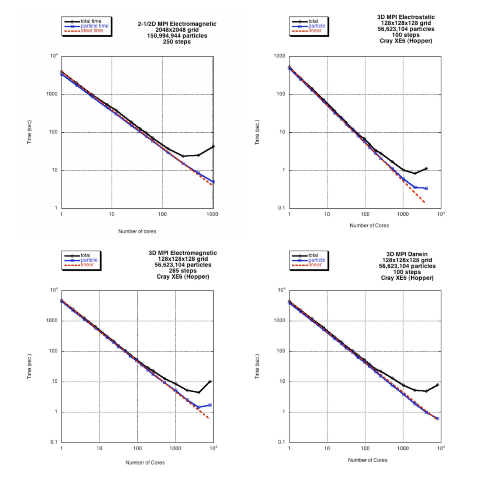

These codes illustrate how to use domain decomposition with message-passing (MPI). This is the dominant
programming paradigm for PIC codes today.

The 2D codes use only a simple 1D domain decomposition. The algorithm is described in detail in Refs.
[2-3]. For the 2D electrostatic code, a typical execution time for the particle part of this code is about
140 ps/particle/time-step with 256 MPI nodes. For the 2-1/2D electromagnetic code, a typical execution time
for the particle part of this code is about 400 ps/particle/time-step with 256 MPI nodes. For the 2-1/2D
Darwin code, a typical execution time for the particle part of this code is about 1.15 ns/particle/time-step
with 256 MPI nodes.

The 3D codes use a simple 2D domain decomposition. For the 3D electrostatic code, a typical execution
time for the particle part of this code is about 150 ps/particle/time-step with 512 MPI nodes. For the 3D
electromagnetic code, a typical execution time for the particle part of this code is about 360 ps/particle/time-step
with 512 MPI nodes. For the 3D Darwin code, a typical execution time for the particle part of this code is
about 1.0 ns/particle/time-step with 512 MPI nodes.

The CPUs (2.67GHz Intel Nehalem processors) were throttled down to 1.6 GHz for these benchmarks.

Electrostatic:  

- 1. 2D Parallel Electrostatic Spectral code: [ppic2](/downloads/ppic2.tar.gz)
- 2. 3D Parallel Electrostatic Spectral code: [ppic3](/downloads/ppic3.tar.gz)

Electromagnetic:  

- 3. 2-1/2D Parallel Electromagnetic Spectral code: [pbpic2](/downloads/pbpic2.tar.gz)
- 4. 3D Parallel Electromagnetic Spectral code: [pbpic3](/downloads/pbpic3.tar.gz)

Darwin:  

- 5. 2-1/2D Parallel Darwin Spectral code: [pdpic2](/downloads/pdpic2.tar.gz)
- 6. 3D Parallel Darwin Spectral code: [pdpic3](/downloads/pdpic3.tar.gz)

*Figures below: Performance of 2-1/2D electromagnetic and 3D electrostatic, electromagnetic, and darwin MPI
codes as a function of the number of cores. Dashed red line is ideal scaling, blue shows particle time, black
shows total time. Degradation of total time is due to the all to all transpose in the FFT, which for large number
of cores is dominated by message latency. Particle time continues to scale well.*

Figure details (click to enlarge): [Figure 1](./images/2dmpitiming1.jpeg);
[Figure 2](./images/fppic3.jpeg); [Figure 3](./images/fpbpic3.jpeg);
[Figure 4](./images/fpdpic3.jpeg).

Want to contact the developer? Send mail to Viktor Decyk
at [decyk@physics.ucla.edu](mailto:decyk@physics.ucla.edu).
