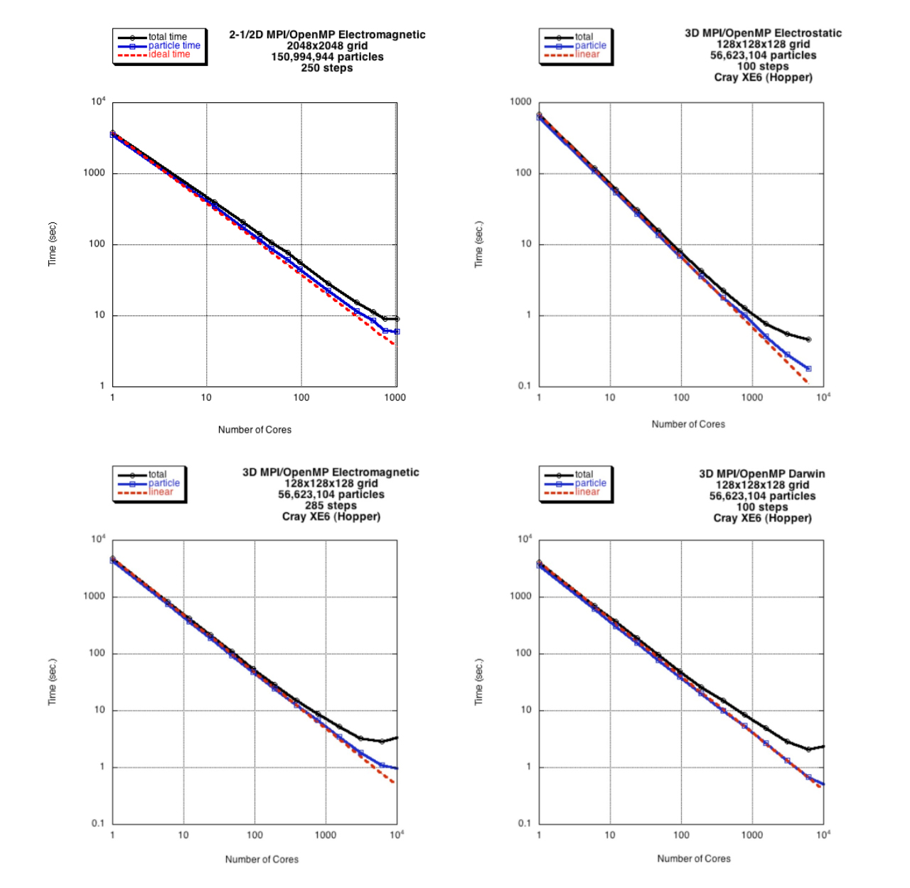

These codes illustrate how to use a hybrid shared/distributed memory algorithm, with a tiled scheme on each
shared memory multi-core node implemented with OpenMP, and domain decomposition connecting such nodes implemented
with MPI. The algorithms are described in detail in Refs. [2-4].

For the 2D electrostatic code, a typical execution time for the particle part of this code is about 80
ps/particle/time-step with 576 processing cores. For the 2-1/2D electromagnetic code, a typical execution time
for the particle part of this code is about 230 ps/particle/time-step with 576 processing cores. For the 2-1/2D
Darwin code, a typical execution time for the particle part of this code is about 364 ps/particle/time-step with
576 processing cores. The CPUs (2.67GHz Intel Nehalem processors) were throttled down to 1.6 GHz for these
benchmarks.

For the 3D electrostatic code, a typical execution time for the particle part of this code is about 110
ps/particle/time-step with 768 processing cores. For the 3D electromagnetic code, a typical execution time f
or the particle part of this code is about 280 ps/particle/time-step with 768 processing cores. For the 3D
Darwin code, a typical execution time for the particle part of this code is about 715 ps/particle/time-step
with 768 processing cores. The CPUs (2.67GHz Intel Nehalem processors) were throttled down to 1.6 GHz for
these benchmarks.

Electrostatic:  

- 1. 2D Parallel Electrostatic Spectral code: [mppic2](/downloads/mppic2.tar.gz)
- 2. 3D Parallel Electrostatic Spectral code: [mppic3](/downloads/mppic3.tar.gz)

Electromagnetic:  

- 3. 2-1/2D Parallel Electromagnetic Spectral code: [mpbpic2](/downloads/mpbpic2.tar.gz)
- 4. 3D Parallel Electromagnetic Spectral code: [mpbpic3](/downloads/mpbpic3.tar.gz)

Darwin:  

- 5. 2-1/2D Parallel Darwin Spectral code: [mpdpic2](/downloads/mpdpic2.tar.gz)
- 6. 3D Parallel Darwin Spectral code: [mpdpic3](/downloads/mpdpic3.tar.gz)

*Figure below: Performance as a function of the number of cores. Dashed red line is ideal scaling, blue
shows particle time, black shows total time. Degradation of total time is due to the all to all transpose in
the FFT, which for large number of cores is beginning to be dominated by message latency. The degradation is
considerably less than in the MPI-only case.*

Figure details (click to enlarge): [Figure 1](./images/timing_fmpbpic2.png);
[Figure 2](./images/fmppic3.jpeg); [Figure 3](./images/fmpbpic31.jpeg);
[Figure 4](./images/fmpdpic3.jpeg).

Want to contact the developer? Send mail to Viktor Decyk
at [decyk@physics.ucla.edu](mailto:decyk@physics.ucla.edu).
