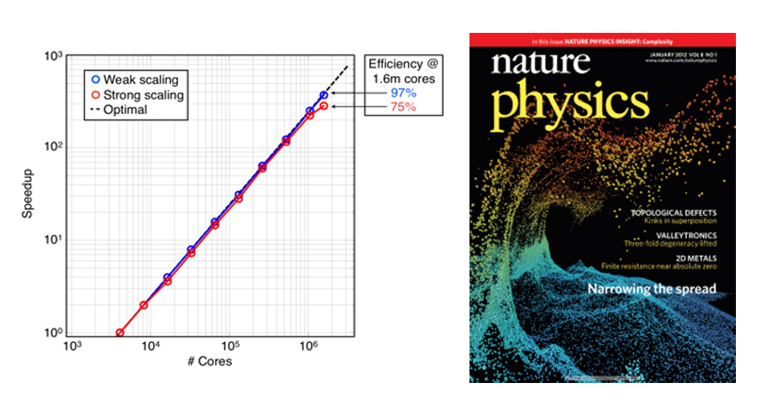
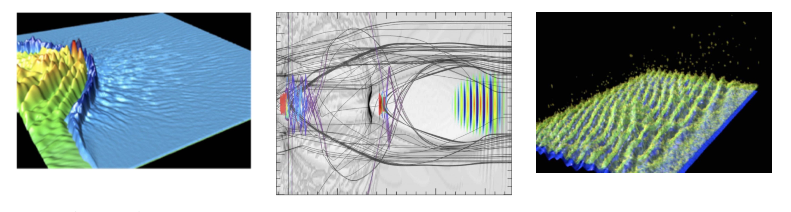

**Access:** OSIRIS is open source. Downloads, documentation and community resources are at
[osiris-code.github.io](https://osiris-code.github.io/).

For more than two decades, we and our collaborators in the OSIRIS consortium have developed and
continue to upgrade a state-of-the-art, fully explicit, multi-dimensional, fully parallelized, fully
relativistic PIC code called OSIRIS and a set of sophisticated diagnostic and visualization packages [1-2].
OSIRIS is a mature code that has been run for well over several hundred million core hours and is used by many groups in the US
and around the world on a wide range of physics problems. It is highly optimized on a single core (for linear and
higher-order particle shapes), and it has a long record of scaling on leadership-class machines: in 2011 it was
featured in the DOE Office of Advanced Scientific Computing Research software effectiveness program, scaling to the
full Jaguar machine (220,000 cores); it later scaled to more than 1.5 million cores on Sequoia at LLNL (Figure 1)
and sustained more than 2.2 PFlops on Blue Waters.

OSIRIS now also runs on GPUs. A CUDA extension brings GPU acceleration to the full code, with excellent weak
scaling on NERSC's Perlmutter; node for node, the GPU version runs up to 14 times faster and is about 7 times more
energy efficient than the optimized CPU code [4]. The GPU version is not yet part of the open-source release;
it will be included in a future release.

*Figures: Figure 1 (left): Figure 1: Weak and strong scaling results on the Sequoia supercomputer at
LLNL. For weak scaling, OSIRIS is shown to be > 97% efficient on > 1.5 million cores. For strong scaling,
the code is 79% efficient on the full Sequoia machine; Figure 2 (right): OSIRIS simulation from the discovery of
a laser-plasma acceleration mechanism that generates 20 MeV proton beams with a 1% spread, shown on the
Nature cover.*

OSIRIS is written in an object-oriented style in modern Fortran, which allows for the re-use of highly
reliable legacy Fortran code while allowing for the rapid development of new modules. Over the years,
many new features have been added that improve both the speed and functionality of OSIRIS. The use of
higher order particle shapes permits the use of large cells (compared to the Debye length) without numerical
heating. It can use either momentum (uniform) or energy conserving (non-uniform) field interpolation. It can
run using a moving window to efficiently model short pulses and it has Perfectly Matched Layers for absorbing
electromagnetic waves at the boundaries. The parallelization is done either using domain decomposition with
MPI across all cores or by using a hybrid approach where MPI is used across nodes and OpenMP is used to launch
threads on the cores on a node. It also has dynamic load balancing routines for the MPI piece. There is a
relativistic two body Coulomb collision model as well as a beta version of a hybrid algorithm (OSIRIS-H, [3])
which pushes particles throughout all regions including collisions, but in a high density region (collisional)
MHD field equations are used to solve for the fields. The MHD field equations do not support high frequency
waves so larger time steps can be used. This could be of use when modeling ion acceleration from laser-solid
interactions. OSIRIS can model laser wakefield acceleration in a Lorentz boosted frame and solve for the laser
fields using an envelope equation and a ponderomotive guiding center pusher for the particles.

OSIRIS can also be run in quasi-3D
using hybrid r-z PIC with a gridless phi. The fields (including currents) are expanded into an arbitrary
number of azimuthal harmonics. This allows modeling lasers and plasma waves with the correct self-focusing
geometry in which the spot sizes have nearly azimuthal symmetry. A hybrid FFT/finite-difference field
solver can eliminate the numerical Cerenkov instability. OSIRIS is also the engine behind our educational
[JupyterPIC](/software/jupyterpic) notebooks.

## Visualization and data analysis

Visualization and data analysis are an essential and nontrivial part of any parallel numerical infrastructure.
Members of the OSIRIS Consortium at UCLA and IST, led by R. A. Fonseca, developed a sophisticated set of data
analysis and visualization routines based on IDL, called VisXD. For Python users, we maintain
[pyVisOS](https://github.com/UCLA-Plasma-Simulation-Group/pyVisOS), a framework for analyzing and visualizing
OSIRIS HDF5 output. The data in our production
codes is written in HDF5 so that output can be easily viewed from other public or private analysis and visualization
routines. Other analysis routines commonly used are Matlab and Visit. Examples from VisXD and Visit are shown below.
We have also developed diagnostics and analysis tools specific to the study of the nonlinear optics of plasmas.
These include diagnosing the reflection and absorption of laser light and the energy flux of electrons crossing
virtual or real boundaries in the plasma.

*Figures: Figure 3 (left): Figure 3: Images of laser and density in a fast ignition relevant simulation;
Figure 4 (middle): Laser and plasma density from a laser wakefield simulation. We can tag particles of interest
and plot their trajectories; Figure 5 (right): Plasma waves and electrons in a High-Frequency-Hybrid-Instability
simulation showing how the hot electrons are affected by a spectrum of plasma waves.*

## References

[1] R. G. Hemker, “Particle-In-Cell Modeling of Plasma-Based Accelerators in Two and Three Dimensions,”
Ph.D. dissertation, University of California, Los Angeles (2000). [Arxiv link](http://arxiv.org/abs/1503.00276)

[2] R. A. Fonseca, L. O. Silva, F. S. Tsung, V. K. Decyk, W. Lu, C. Ren, W. B. Mori, S. Deng, S. Lee,
T. Katsouleas, and J. C. Adam, Lecture Notes in Computer Science (Springer, Heidelberg, 2002), Vol. 2331,
pp. 342–351; R. A. Fonseca et al, “One-to-one direct modeling of experiments and astrophysical scenarios:
pushing the envelope on kinetic plasma simulations,” Plasma Phys. Control. Fusion 50, 124034 (2008).
[doi link](http://dx.doi.org/10.1088/0741-3335/50/12/124034)

[3] F Fiuza, M Marti, R A Fonseca, L O Silva, J Tonge, J May, and W B Mori, “Efficient modeling of
laser–plasma interactions in high energy density scenarios,” Plasma Phys. Control. Fusion 53, 074004
(2011). [doi link](http://dx.doi.org/10.1088/0741-3335/53/7/074004)

[4] R. P. Lee, J. R. Pierce, K. G. Miller, M. Almanza, A. Tableman, V. K. Decyk, R. A. Fonseca, E. P. Alves and
W. B. Mori, "Acceleration of the particle-in-cell code Osiris with graphics processing units," J. Plasma Phys. 91,
E8 (2025). [doi link](https://doi.org/10.1017/S0022377824001569)
