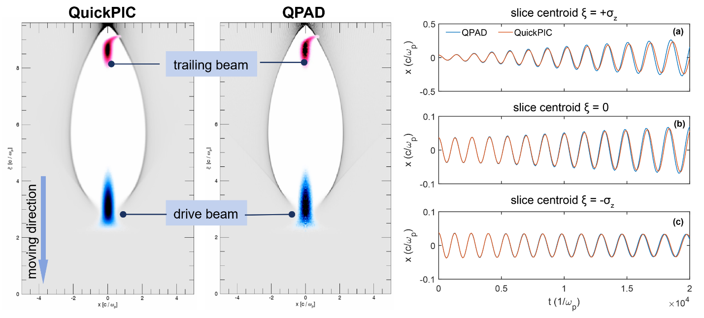
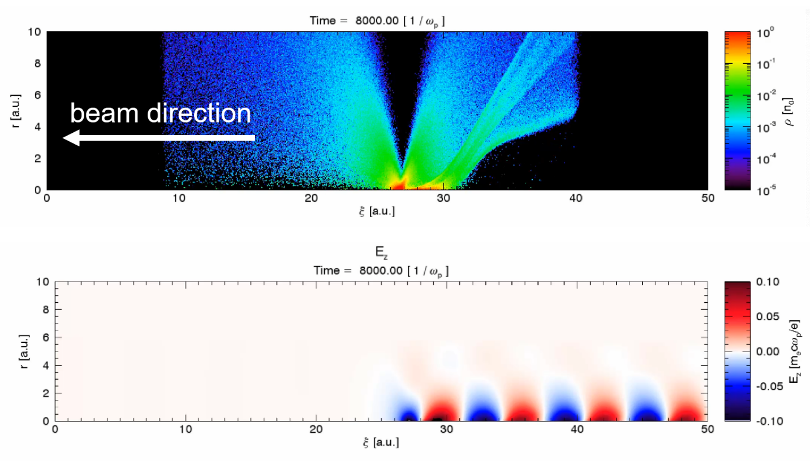

QPAD (QuickPIC with Azimuthal Decomposition) is a fully relativistic, quasi-3D parallel (MPI-based) quasi-static PIC code written in Fortran 2003. QPAD is based on the computational workflow of the full 3D PIC code QuickPIC. It is the first PIC code that combines both quasi-static approximation and azimuthal harmonic decomposition. QPAD is thus a very efficient code for modeling short-pulse laser or relativistic charged particle beam–plasma interactions; some illustrative use-cases of QPAD are presented in the figures below. QPAD can lead to several orders of magnitude computational speed up compared with 3D quasi-static PIC codes (such as QuickPIC). QPAD utilizes synchronous parallelism in the transverse direction and asynchronous parallelism (pipeline) in the longitudinal direction, which maximizes the parallel scalability.

Due to the advantages of high performance and small memory footprint, QPAD provides many complementary advantages for other full-3D codes and is especially suitable for the following circumstances:

- Physics problems relatively small amounts of azimuthal asymmetry
- No self-injected particles
- Simulations requiring ultra-high spatial resolution
- Start-to-end simulations with ultra-long distances
- Efficient parameter scanning for parameter optimization

The current version includes many useful features for simulations of plasma-based accelerators:

- Various particle pushers
- Field-induced ionization (ADK model)
- Spin dynamics for beam particles
- Various initial profiles for beams and plasma species
- Importing beam particles from output files of other codes
- Parallel cyclic reduction field solver

Plans for additional simulation features and hardware support include:

- GPU support
- Dynamic load balancing
- Adaptive “1D” and “2D” time steps
- Ponderomotive guiding center model for laser
- Radiation reaction
- Adaptive maximum azimuthal mode number

For more information and latest updates on QPAD, please visit <https://github.com/UCLA-Plasma-Simulation-Group/QPAD>

*Figure 1: Comparable simulations for hosing instability problem in plasma acceleration using the full 3D code (QuickPIC) vs. reduced code (QPAD) for a round beam with a small offset. An ultra-long distance (2x104 characteristic plasma lengths) is simulated in 5,000 steps. There are total of four azimuthal Fourier modes (from m=0 to m=3) evolving in the QPAD simulation and the results agree well with those of the full 3D simulation, while the total computing time is reduced by ~100x.*

*Figure 2: Simulation for a PWFA driven by a proton beam with a “flying focal spot”. The simulation has a large field of view and high spatial resolution. The simulation box is 200-by-50 characteristic plasma lengths large (the figure has been cropped) containing 12,000-by-3,000 spatial grid points. This simulation was carried out on a desktop computer.*

## References

Li, F., An, W., Decyk, V. K., Xu, X., Hogan, M. J., & Mori, W. B., "A quasi-static particle-in-cell algorithm based on an azimuthal Fourier decomposition for highly efficient simulations of plasma-based acceleration: QPAD", Computer Physics Communications, 261, 107784. [doi link](https://doi.org/10.1016/J.CPC.2020.107784)
