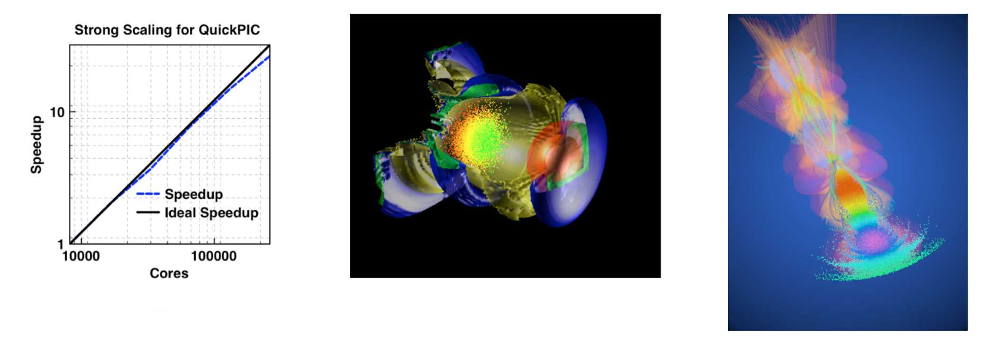

**Access**: You can obtain QuickPIC from Github [here](https://github.com/UCLA-Plasma-Simulation-Group/QuickPIC-OpenSource.git).

Description: QuickPIC [1, 2] is a 3D fully parallelized, fully relativistic, three-dimensional quasi-static
PIC code. It was the first 3D quasi-static code and remains the only fully 3D quasi-static PIC code.
It was built from components from the UPIC Framework. The algorithm is based on the quasi-static
approximation, which separates out the time scale of the evolution of the driver from the plasma
evolution and reduces a fully 3D EM field solve and particle push into a sequence of 2D solves and
particle pushes. A predictor-corrector loop is required and only one iteration is often needed even
for nonlinear problems. For the laser driver, the ponderomotive guiding center approximation is used.
QuickPIC results agree with full PIC codes such as OSIRIS results for problems of interest. A field
ionization module based on the ADK model is implemented. With a pipelining algorithm and improvements
to the iteration loop, QuickPIC achieves good strong scaling to more than 100,000 cores on Titan and
Blue Waters.

*Figure 1: Strong Scaling for QuickPIC; Figure 2: QuickPIC simulation of Laser Wake Field Accelerator
(LWFA) with an electron beam load (Image made by Weiming An); Figure 3: QuickPIC simulation of two-bunch
electron beam driven Plasma Wake Field Accelerator (PWFA) at FACET (Image made by Weiming An). It was chosen
as the cover of Nature on Nov 6th 2014.*

## References

[1] C. Huang, V. K. Decyk, C. Ren, M. Zhou, W. Lu, W. B. Mori, J. H. Cooley, T. M. Antonsen, Jr., and
T. Katsouleas, “Quickpic: A highly efficient particle-in-cell code for modeling wakefield acceleration
in plasmas,” J. Comput. Phys. 217, 658 (2006). [doi link](http://dx.doi.org/10.1016/j.jcp.2006.01.039)

[2] W. An, V. K. Decyk, W. B. Mori, and T. M. Antonsen, Jr., “An improved iteration loop for the
three dimensional quasi-static particle-in-cell algorithm: Quickpic,” J. of Comp. Phys. 250, 165
(2013). [doi link](http://dx.doi.org/10.1016/j.jcp.2013.05.020)
